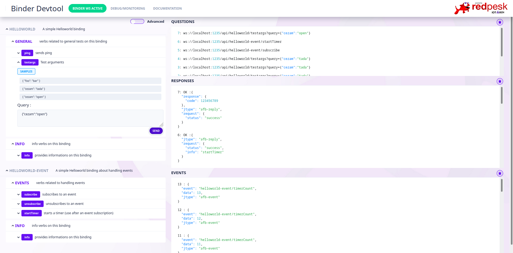

# AFB UI Devtools (Binder Devtool)

The **AFB UI Devtools** (Binder Devtool) is a web-based graphical interface built with Angular and Nebular. It automatically discovers, inspects, and tests the APIs and verbs exposed by an **Application Framework Binder** (`afb-binder`) over WebSocket.



---

## Features

- **Automatic API Discovery**: Automatically connects to the binder via WebSocket and populates available APIs and verbs.
- **Two Exploration Modes**:
  - **General Mode**: Groups verbs with descriptions, predefined actions, and sample payloads (based on API `info` verb metadata).
  - **Advanced Mode**: Direct access to all APIs and verbs exposed by the running binder.
- **Interactive Verb Testing**:
  - Form-based parameter input with JSON syntax validation.
  - **Multi-argument support**: Support for calls with multiple query arguments (`Arg 0`, `Arg 1`, ...) for AFB v4 bindings.
- **Real-Time Monitoring Panels**:
  - **Questions**: Live log of outgoing API calls with parameters.
  - **Responses**: Detailed replies with status code (`OK` / `ERROR`), execution results, and syntax highlighting.
  - **Events**: Real-time log of events pushed by subscribed APIs.
- **Responsive Layout**: Clearable log panes, collapsible accordions, and dark/light theme support.

---

## Prerequisites

- **Node.js**: `>= 18` (LTS recommended)
- **npm**: `>= 9`
- **afb-binder**: Application Framework Binder installed on your system (e.g., from redpesk SDK or built from source).

---

## Getting Started

### 1. Installation

Clone the repository and install dependencies:

```bash
git clone https://github.com/redpesk-devtools/afb-ui-devtools.git
cd afb-ui-devtools
npm install
```

### 2. Build

Build the production or development bundles:

```bash
# Build for development
npm run build

# Build for development with watch mode (auto-rebuild on changes)
npm run watch

# Build for production
npm run build:prod
```

Compiled assets are generated into the `dist/` directory.

---

## Running with `afb-binder`

The web application is designed to be served directly by `afb-binder` using the `--roothttp` option.

### Basic Usage

From the root directory of `afb-ui-devtools`:

```bash
afb-binder --binding=<path-to-your-binding.so> --roothttp=dist --port=1234 -vvv
```

Then open your browser and navigate to:
```
http://localhost:1234
```

### Examples

#### Testing with `ping-binding` (AFB v4 Multi-Parameters)
```bash
afb-binder --binding=/home/sylvain/Work/PROJETS/ping-binding/ping-binding.so --roothttp=dist --port=1234 -vvv
```

#### Testing with `helloworld-binding`
```bash
afb-binder --binding=/usr/redpesk/helloworld-binding/lib/afb-helloworld-skeleton.so --roothttp=dist --port=1234 -vvv
```

### Running with Angular Dev Server (`ng serve`)

If you want live reloading during UI development:

1. Start the binder without serving HTTP files (or on a dedicated port):
   ```bash
   afb-binder --binding=<path-to-binding.so> --port=1234 -vvv
   ```
2. Start the Angular development server:
   ```bash
   npm start # or: ng serve --port 4200
   ```
3. Connect the UI to `localhost:1234` through the connection settings bar.

---

## Multi-Parameters Usage (AFB v4)

For APIs running under AFB Binding Version 4 that support multiple arguments:

1. Open the verb accordion (e.g. `ping/ping`).
2. Toggle the **Multi-arguments** mode.
3. Use **Add Argument** to add `Arg 0`, `Arg 1`, etc.
4. Each argument can be formatted as a JSON object, array, or primitive string.
5. Click **Send**:
   - The binder receives the array of arguments.
   - The **Questions** panel logs the call with query parameters `arg0=...&arg1=...`.
   - The **Responses** panel displays each returned argument individually labeled `[Arg 0]`, `[Arg 1]`, etc.

---

## Project Scripts

| Script | Description |
|---|---|
| `npm run build` | Builds the app in development mode into `dist/` |
| `npm run build:prod` | Sets git tag version and builds optimized production bundle |
| `npm run watch` | Watches source files and rebuilds incrementally |
| `npm run test` | Runs unit tests with Karma |
| `npm run lint` | Runs ESLint and stylelint checks |
| `npm run lint:fix` | Automatically fixes linting errors |

---

## Documentation & References

- [Full Documentation](docs/monitoring.md)
- [Developer Setup Guide](docs/internal.md)
- [redpesk Documentation](https://docs.redpesk.bzh/)

---

## License

Licensed under [GNU General Public License v3.0](LICENSE.GPLv3).
